# curtis-watercolor

Physically based watercolor in Rust: an implementation of Cassidy J. Curtis, Sean E. Anderson,
Joshua E. Seims, Kurt W. Fleischer and David H. Salesin,
[*Computer-Generated Watercolor*](https://grail.cs.washington.edu/projects/watercolor/) (SIGGRAPH 1997).

A painting is a stack of **glazes**: each glaze is one wash of one pigment, simulated on its own
over procedural paper, then layered optically with the **Kubelka–Munk** model.

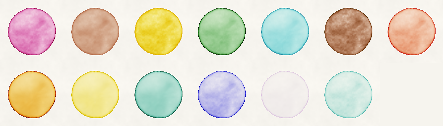

- **Water** flows inside the wet area by the shallow-water equations on a staggered grid, damped,
  pushed downhill by the paper's slope, and relaxed to be divergence-free.
- **Pigment** rides the water, settles onto the paper and lifts off again according to its
  density, staining power and granulation: granulating pigments collect in the paper's valleys.
- **Edge darkening**: water drains near the rim of the wet area, so pigment migrates outward
  and leaves the dark edge of real watercolor.
- **Kubelka–Munk glazing**: each pigment absorbs and scatters per colour channel, so a glaze
  over another darkens and shifts hue like paint rather than blending like transparency. The
  paper's twelve pigments are included, and you can define your own from how a unit layer looks
  over white and over black.
- **Paper** is a height field of soft noise and fibres that repeats on any lattice (square,
  hexagonal, or simply large), so baked glazes can agree with the paper drawn under them in a
  tiled game.

No engine dependency (only `libm`): it turns masks and pigment loads into pigment thicknesses and
colours. Use it offline to bake textures or in a tool to paint images. The compositing is also
available as a WGSL snippet, [`shaders/kubelka_munk.wgsl`](shaders/kubelka_munk.wgsl), for
rendering glazes on the GPU. The simulation is deterministic: the same inputs and seeds give the
same painting on every platform.

## Example

```rust
use curtis_watercolor::{Glaze, Lattice, Paper, Params, by_name, composite, to_srgb8};

let n = 128;
let paper = Paper::generate(128, 1, Lattice::square(n as f32));
let height: Vec<f32> = (0..n * n).map(|c| paper.at([(c % n) as f32, (c / n) as f32])).collect();
// The wet area: a disc.
let mask = (0..n * n).map(|c| ((c % n) as f32 - 64.0).hypot((c / n) as f32 - 64.0) < 40.0).collect();

let blue = by_name("French Ultramarine").unwrap();
let mut glaze = Glaze::new(n, Params::default(), blue, mask, height);
glaze.load_pigment(0.5);
for _ in 0..200 {
    glaze.step();
}
let thickness = glaze.thickness();
let pixel = composite([0.96, 0.94, 0.89], &[(&blue, thickness[64 * n + 64])]).map(to_srgb8);
```

`cargo run --release --example swatches` paints every pigment and writes `out/swatches.png`.

## Parameters

Each strip is the same French Ultramarine wash with one setting changed; the bold value is the
one used everywhere else (the paper's `Params::default()`, ultramarine's own properties, a load of
0.5 and 200 steps). `cargo run --release --example parameters` paints them into `out/parameters/`.

### `Params::edge_darkening` (η)

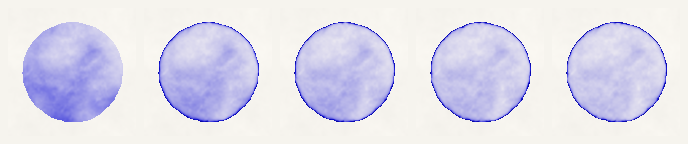

0 · 0.015 · **0.03** · 0.06 · 0.12. Without it the pigment pools wherever the paper's slope sends the water. With it, water drains toward the rim, which darkens while the middle clears.

### `Params::viscosity` (μ)

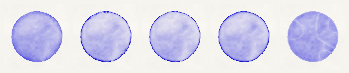

0 · 0.03 · **0.1** · 0.3 · 0.6. Little change across the stable range. At 0.6 the explicit step goes unstable and leaves rings: keep it below about 0.25.

### `Params::drag` (κ)

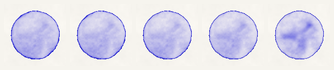

0 · 0.003 · **0.01** · 0.05 · 0.2. Strong drag stops the water before it reaches the rim, so the pigment dries in blotches where it was.

### `Params::slope`

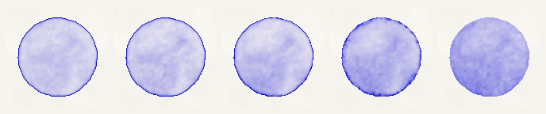

0 · 0.3 · **1** · 3 · 8. A steeper push sends the water into the paper's valleys: the wash mottles and the dark rim fades.

### `Params::blur` (K)

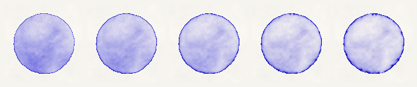

2 · 5 · **10** · 18 · 30. A wider band drains toward the rim: a broader dark edge and a paler centre.

### `Pigment::density` (ρ)

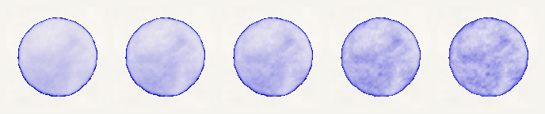

0.003 · 0.006 · **0.01** · 0.03 · 0.1. Heavy pigment settles before the water can move it: more paper texture, less edge.

### `Pigment::staining` (ω)

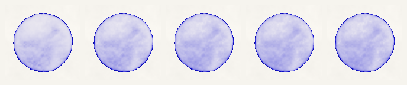

0.3 · 1 · **3.1** · 6 · 12. Barely visible in a still wash: staining resists lifting pigment that has settled, which matters when water keeps moving over it.

### `Pigment::granulation` (γ)

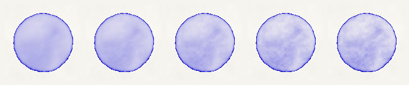

0 · 0.3 · 0.6 · **0.91** · 1. Smooth at 0; grainier as the pigment sorts into the paper's valleys.

### Load (`Glaze::load_pigment`)

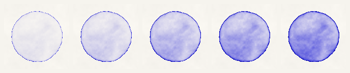

0.1 · 0.25 · **0.5** · 0.75 · 1. How much pigment the brush carries.

### Steps (`Glaze::step`)

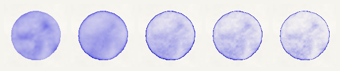

20 · 60 · **200** · 400 · 800. How long the wash stays wet. Early on it shows the blotches of the first flow; given longer, the edge darkens and the centre clears.

## How it maps to the paper

| Paper | Here |
|---|---|
| §4.1 paper generation | [`paper`](src/paper.rs), periodic via [`lattice`](src/lattice.rs) |
| §4.3 moving water (`UpdateVelocities`, `RelaxDivergence`, `FlowOutward`) | [`sim`](src/sim.rs) |
| §4.4 moving pigment, §4.5 adsorption and desorption | [`sim`](src/sim.rs) |
| §4.6 capillary flow and backruns | not implemented |
| §5 Kubelka–Munk optics, §5.1 pigments from colours, Figure 5 palette | [`pigment`](src/pigment.rs), [`render`](src/render.rs) |

Departures from the paper's pseudocode, all for speed or robustness:

- Only wet cells and the faces between them are simulated.
- The divergence is relaxed in place, which converges faster than two buffers.
- Water speed is capped at two cells per step, which catches rare runaways.

## Used by

[Bestagon](https://bestagon.casaroja.es), a hexagonal rotation puzzle, bakes its watercolor
tileset with this crate.

## License

Licensed under either of [Apache License, Version 2.0](LICENSE-APACHE) or
[MIT license](LICENSE-MIT) at your option.

Unless you explicitly state otherwise, any contribution intentionally submitted for inclusion in
this crate by you, as defined in the Apache-2.0 license, shall be dual licensed as above, without
any additional terms or conditions.
